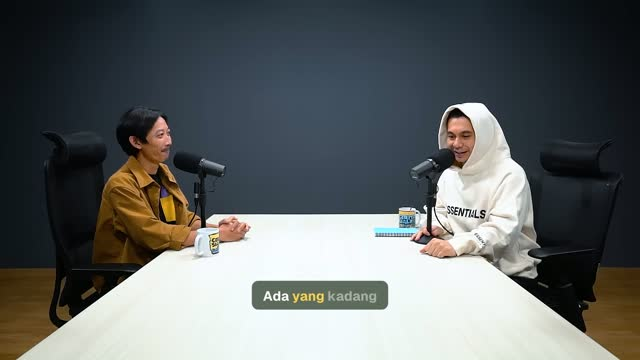
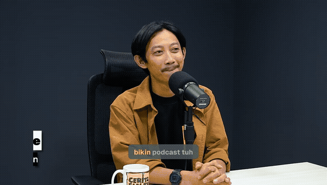

# CaptionYourVideo

Drop a video in, get it back with animated word-by-word captions burned in. Speech is transcribed locally with Whisper, Claude decides where each caption breaks and which words to highlight, and ffmpeg renders the result.

One command, one video in, one video out.

## Why this exists

I had videos that needed captions inside the video itself. The AI caption tools I found were all paid, and I did not want another subscription. I already pay for AI access (OpenAI, Anthropic and others) and route it through [9router](https://github.com/decolua/9router). So instead of paying again, this tool uses the AI I already have: put a video in, run one command, get the captioned video back. Simple, fast, and little setup.

The recommended way to run it is Docker Compose, so the only thing you install is Docker.

## Preview

| | Input | Output |
|---|---|---|
| **English** ([source](https://www.youtube.com/watch?v=prtAauDy2KE)) |  |  |
| **Indonesian** ([source](https://www.youtube.com/watch?v=9xo4pOaTsxY)) |  |  |

Captions in motion: upcoming words are grey, the spoken word lights up yellow, spoken words turn white, and keywords Claude picks stay yellow.

| English | Indonesian |
|---|---|
|  |  |

## Features

- Word-level timing from local Whisper (`large-v3-turbo` by default). Works for any language Whisper supports; tested with English and Indonesian.
- Claude plans the captions: short one-line chunks that follow the speaker's rhythm, highlighted keywords, and fixes for obvious transcription mistakes.
- Live progress in the terminal: transcript lines, each caption as Claude streams it, then the ffmpeg render.
- Caption colors and box opacity are set from `.env`.
- Works with the official Anthropic API, [9router](https://github.com/decolua/9router), or any Anthropic-compatible gateway: set `ANTHROPIC_BASE_URL`.
- Runs natively with Bun or as a one-shot Docker container.

## Requirements

**Docker (recommended):** Docker with Compose v2. Nothing else.

**Native:**

| Tool | Version | Used for |
|------|---------|----------|
| [Bun](https://bun.sh) | 1.3+ | Runs the app and tests |
| [ffmpeg](https://ffmpeg.org) | with libass | Reads and renders video |
| [uv](https://docs.astral.sh/uv/) | 0.8+ | Runs the Whisper script with its own Python deps |
| Python | 3.10+ | Installed by uv if missing |

Both setups need a Claude API key (or a 9router key) and about 2 GB of disk for the Whisper model. The model downloads once on the first run.

## Quick start

```bash
git clone https://github.com/oriastanjung/caption-your-video.git
cd caption-your-video
cp .env.example .env          # then set ANTHROPIC_API_KEY
cp /path/to/your-video.mp4 input/input.mp4
```

**With Docker (recommended)**, one shot: build, caption, exit.

```bash
docker compose up --build
```

**Native:**

```bash
bun install
bun run start
```

The result is written to `output/output.mp4`, with the subtitle file next to it as `output/output.ass`. The input file must be named `input/input.mp4`.

The first run downloads the Whisper model (about 1.6 GB). Docker keeps it in the `whisper-models` volume and native runs keep it in `~/.cache/huggingface`, so later runs start right away.

### Docker build and run times

Measured on a 12-thread CPU with no GPU, over a slow connection:

| | Result |
|---|---|
| Image size | 1.36 GB |
| First build (nothing cached) | about 7.5 minutes, almost all of it downloading Whisper's Python packages |
| Rebuild after changing app code | 3 to 4 seconds |
| Rebuild after changing Whisper dependencies | about 3 minutes (downloaded packages are reused from the build cache) |
| Captioning a 36-second video, model already downloaded | about 70 seconds |

The Dockerfile orders its layers from least to most often changed, so editing TypeScript, prompts or fonts never reinstalls Whisper. Package downloads use BuildKit cache mounts, and the Whisper model lives in a named volume, so neither is downloaded twice.

## Configuration

All settings live in `.env`. See [.env.example](.env.example).

| Variable | Default | Meaning |
|----------|---------|---------|
| `ANTHROPIC_API_KEY` | required | Claude API key, or your gateway key |
| `ANTHROPIC_BASE_URL` | Anthropic API | Base URL of an Anthropic-compatible gateway |
| `ANTHROPIC_MODEL` | `claude-haiku-5-5` | Model that plans the captions |
| `WHISPER_MODEL` | `large-v3-turbo` | `tiny`, `base`, `small`, `medium`, `large-v3`, `large-v3-turbo` |
| `HF_TOKEN` | empty | Optional Hugging Face token for faster model downloads |
| `WHISPER_PYTHON` | empty | Python that already has the Whisper packages. The Docker image sets it; leave it empty to let uv handle them |
| `CAPTION_BOX_COLOR` | `#4D5B4A` | Caption box color |
| `CAPTION_BOX_OPACITY` | `0.95` | Box opacity, `0` to `1` |
| `CAPTION_UPCOMING_COLOR` | `#A8B0A5` | Words not spoken yet |
| `CAPTION_ACTIVE_COLOR` | `#F9D054` | The word being spoken |
| `CAPTION_SPOKEN_COLOR` | `#FAFAFA` | Words already spoken |
| `CAPTION_KEYWORD_COLOR` | `#F9D054` | Keywords after they are spoken |

### Using 9router

CaptionYourVideo talks to the Anthropic Messages API, so any gateway that speaks it works. For [9router](https://github.com/decolua/9router), point the base URL at your router and use a model or combo name it exposes:

```env
ANTHROPIC_API_KEY=your-9router-key
ANTHROPIC_BASE_URL=https://your-9router-host/v1
ANTHROPIC_MODEL=your-combo-name
```

Caption quality depends on the model. A model that ignores the caption rules may produce long captions or no keywords.

## How it works

```
input/input.mp4
  -> Whisper (local)            words with start and end times
  -> Claude                     caption breaks, keywords, spelling fixes
  -> domain rules               the plan must cover every word, in order
  -> ASS subtitles + ffmpeg     rounded box, word-by-word color, pop-in
  -> output/output.mp4
```

### Why TypeScript and Python, and not only Python

Each language does the part it is best at, and the boundary between them is one small, replaceable script.

- **Python only for transcription.** Transcription uses [faster-whisper](https://github.com/SYSTRAN/faster-whisper), a fast and accurate local Whisper engine built on CTranslate2 that gives word-level timestamps on a plain CPU. It only has a Python API. `scripts/transcribe.py` is about 30 lines: it takes a video, prints words with timings as JSON, and nothing else. Its dependencies are pinned in `scripts/transcribe.py.lock` and installed by uv, so you never manage a virtualenv by hand.
- **TypeScript on Bun for everything else.** Caption planning, validation, layout and rendering are where the logic lives, and they benefit from strict types: the plan Claude returns is checked against the domain rules before anything is rendered. Bun runs TypeScript directly with a built-in test runner and fast startup, and the official Anthropic SDK streams each caption to the terminal as it is planned. Pixel-exact layout of the rounded caption box uses fontkit to measure text with the same metrics libass uses to draw it.
- **The boundary is a port.** The rest of the app only sees a `Transcriber` interface that returns words with times. The Python script could be swapped for whisper.cpp or a hosted speech API by writing one new adapter, without touching the domain or the use case.

A Python-only version would be possible, but it would put the caption rules, the streaming client and the layout code in a language where they are harder to type-check, and gain nothing for the one part that truly needs Python.

### Code layout

The code follows Clean Architecture with a domain-driven core:

```
main.ts               composition root
src/domain/           captions, theme, words: pure rules, no I/O
src/application/      CaptionVideo use case and its ports
src/infrastructure/   Whisper, Claude, ASS, ffmpeg, fontkit and config adapters
prompts/              the caption planning prompt
scripts/              the Whisper transcription script and its lock file
tests/                mirrors src/
```

## Contributing

Contributions are welcome. Read [AGENTS.md](AGENTS.md) first; it is the rulebook for humans and AI agents alike. In short:

1. **Test first.** TDD is mandatory: write a failing test, make it pass, then refactor. Behaviour without a test is not merged.
2. **Respect the layers.** Business rules go in `src/domain`, orchestration in `src/application`, anything that touches an SDK, a process or the file system in `src/infrastructure`.
3. **Always through a pull request**, following the workflow in AGENTS.md:
   1. Check your tools.
   2. Explore the code and existing PRs.
   3. Write the plan first.
   4. Open a draft PR.
   5. Put the plan in the draft PR.
   6. Implement with TDD, one step per commit.
   7. Comment on the PR after every commit with what it did and how you checked it.
   8. Finalize the PR description with the ticked test-case checklist and mark it ready for review.

Before you push:

```bash
bun run typecheck
bun test
```

Report bugs and ideas in [GitHub Issues](https://github.com/oriastanjung/caption-your-video/issues).

## License

[MIT](LICENSE). The bundled Geist font is licensed under the [SIL Open Font License 1.1](licenses/Geist-OFL.txt). The preview stills come from the linked YouTube videos and belong to their owners.
